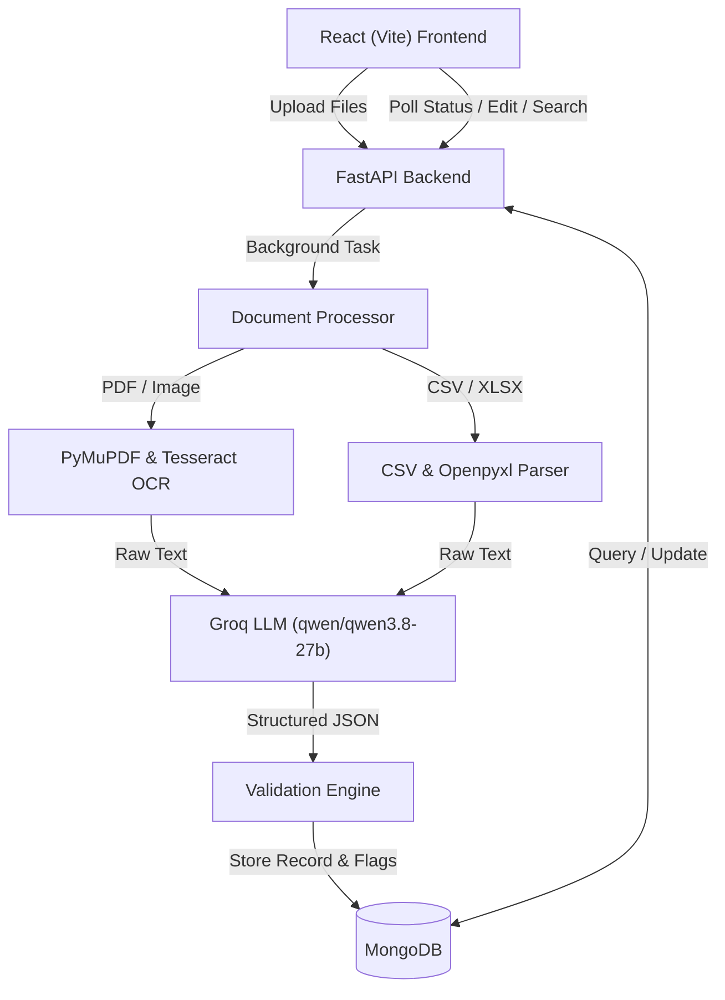
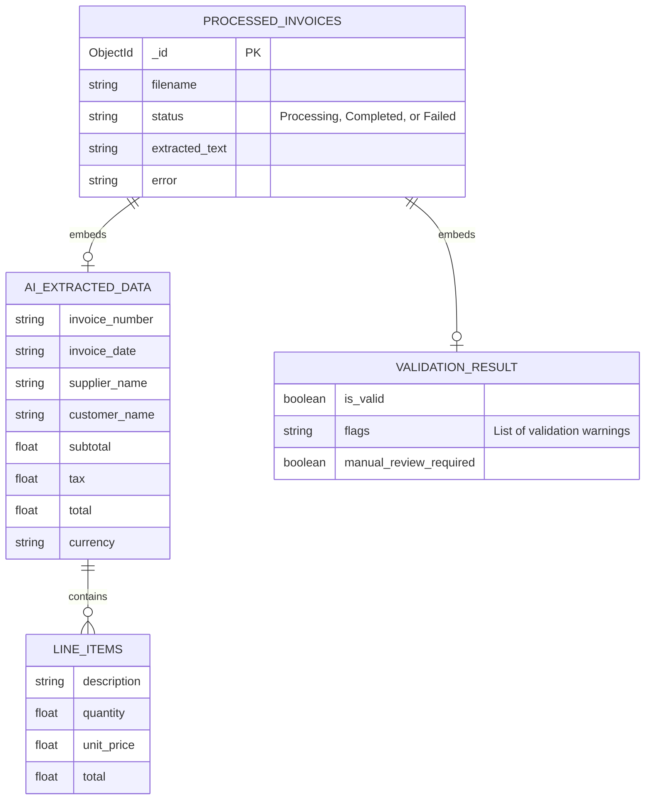

# AI-Powered Document Intelligence System

An end-to-end document processing application that ingests multi-format business documents (PDF, Images, CSV, and Excel), extracts structured invoice fields using OCR and Large Language Models, validates financial consistency, and provides keyword and semantic search through a React web interface.

## Key Features
* **Multi-Format Ingestion:** Supports PDF (`PyMuPDF`), scanned images (`Tesseract OCR`), CSV (`csv`), and Excel spreadsheets (`openpyxl`).
* **Structured AI Extraction:** Extracts invoice metadata and line items into strict JSON using Groq (`qwen/qwen3.8-27b`).
* **Automated Validation Engine:** Detects missing required fields, duplicate invoice numbers in MongoDB, and arithmetic mismatches (`subtotal + tax != total`).
* **Asynchronous Processing:** Handles document uploads via FastAPI background tasks with real-time job status polling.
* **Manual Review & Reprocessing:** Enables manual editing of extracted fields (`PUT /invoice/{job_id}`) and one-click retrying of failed extraction jobs (`POST /reprocess/{job_id}`).
* **Keyword & Semantic Search:** Supports MongoDB regex search alongside LLM-powered conceptual document retrieval.

---

## System Architecture



---

## Database Schema

**Database:** `document_intelligence`  
**Collection:** `processed_invoices`

### Entity-Relationship Diagram



### Document Structure (JSON)

```json
{
  "_id": "ObjectId",
  "filename": "string",
  "status": "Processing | Completed | Failed",
  "extracted_text": "string",
  "error": "string | null",
  "ai_extracted_data": {
    "invoice_number": "string | null",
    "invoice_date": "string | null",
    "supplier_name": "string | null",
    "customer_name": "string | null",
    "subtotal": "number | null",
    "tax": "number | null",
    "total": "number | null",
    "currency": "string | null",
    "line_items": [
      {
        "description": "string",
        "quantity": "number",
        "unit_price": "number",
        "total": "number"
      }
    ]
  },
  "validation": {
    "is_valid": "boolean",
    "flags": ["string"],
    "manual_review_required": "boolean"
  }
}
```

---

## API Endpoints

| Method | Endpoint | Description |
| :--- | :--- | :--- |
| `GET` | `/` | Health check endpoint |
| `POST` | `/upload` | Uploads a document and starts background extraction |
| `GET` | `/status/{job_id}` | Returns processing status, raw text, extracted JSON, and validation flags |
| `PUT` | `/invoice/{job_id}` | Saves manual edits and re-runs validation |
| `POST` | `/reprocess/{job_id}` | Retries AI extraction on a failed job using stored extracted text |
| `GET` | `/search` | Searches invoices (`search_type=keyword` or `search_type=semantic`) |

---

## Setup & Installation Instructions

### Prerequisites
* **Python:** 3.10+
* **Node.js:** v18+
* **MongoDB:** Running locally on `mongodb://localhost:27017`
* **Tesseract OCR:** Installed locally (Default Windows path configured in `main.py`: `C:\Program Files\Tesseract-OCR\tesseract.exe`)

### 1. Clone the Repository
```bash
git clone [https://github.com/Nafizul125/AI-Powered-Document-Intelligence-System.git](https://github.com/Nafizul125/AI-Powered-Document-Intelligence-System.git)
cd AI-Powered-Document-Intelligence-System
```

### 2. Backend Setup (FastAPI)
```bash
# Create and activate virtual environment
python -m venv venv

# Windows (PowerShell)
.\venv\Scripts\activate

# macOS / Linux
source venv/bin/activate

# Install Python dependencies
pip install -r requirements.txt
```

Create a `.env` file in the project root directory and add your credentials:
```env
GROQ_API_KEY=your_groq_api_key_here
MONGO_URI=mongodb://localhost:27017
```

Start the FastAPI backend server:
```bash
python -m uvicorn main:app --reload
```
The backend API runs at `http://127.0.0.1:8000` (Interactive API docs at `http://127.0.0.1:8000/docs`).

### 3. Frontend Setup (React + Vite)
Open a new terminal window and run:
```bash
cd frontend
npm install
npm run dev
```
The web application will be available at `http://localhost:5173`.

---

## Automated Testing & Evaluation

### Running Automated Tests
```bash
pytest test_main.py -v
```

**Measured Test Results:**
* **Total Tests:** 5 / 5 Passed (`test_read_root`, `test_upload_document`, `test_get_status_invalid_id`, `test_get_status_not_found`, `test_search_keyword`)
* **Execution Time:** 3.58 seconds

### Running the Evaluation Script
Make sure the FastAPI server is running on port `8000`, then execute:
```bash
python evaluate.py
```

**Measured Evaluation Metrics:**
* **Document Success Rate:** 100%
* **Failure Rate:** 0%
* **Average Processing Time:** 2.08 seconds per document
* **Total Amount Extraction Accuracy:** 100% (Expected: `1050` | Extracted: `1050`)

---

## AI Prompts & Assisted Development Disclosure

### AI-Assisted Development Disclosure
Google Gemini was used during development to assist with architecture planning, React UI scaffolding, debugging `pytest` asynchronous event-loop behavior with Motor, and drafting project documentation. All core pipelines, API endpoints, automated tests, and evaluation runs were executed and verified locally.

### Production Prompts Used (Groq `qwen/qwen3.8-27b`)

**1. Structured Invoice Extraction Prompt**
```text
Extract the following fields from the invoice text below. 
Return a valid JSON object ONLY. If a field is missing, use null.
Fields to extract: 
- invoice_number
- invoice_date
- supplier_name
- customer_name
- subtotal (numeric)
- tax (numeric)
- total (numeric)
- currency
- line_items (list of objects containing: description, quantity, unit_price, total)

Invoice Text:
{text}
```

**2. Semantic Search Prompt**
```text
You are a semantic search engine. Find documents that match the user's query conceptually.
Query: "{query}".
Documents: {json.dumps(docs_for_ai)}.
Return ONLY a JSON object with key "matched_ids" containing list of matching string IDs.
```