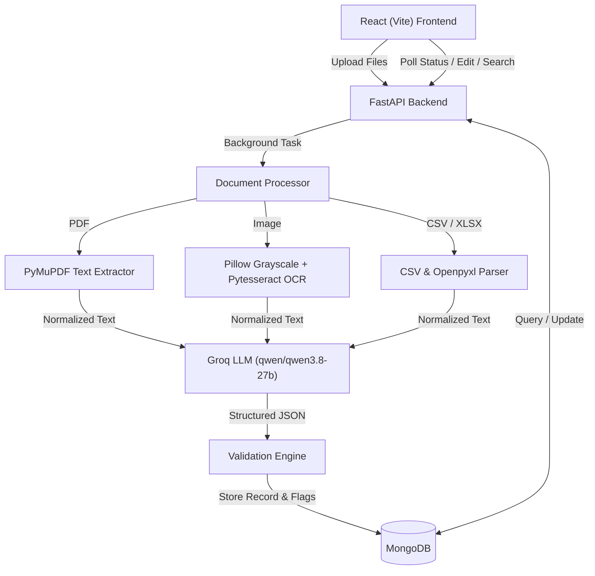
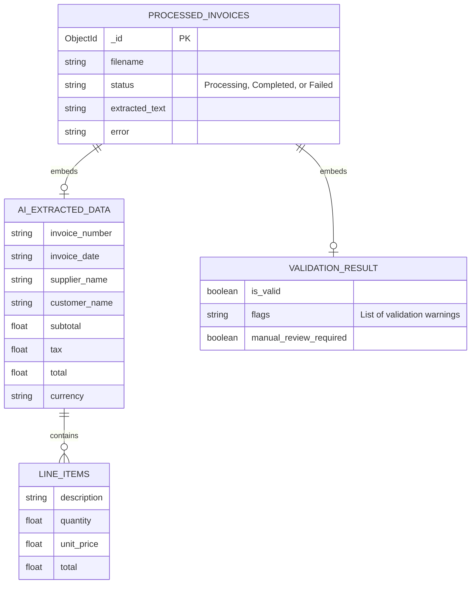

# AI-Powered Document Intelligence System

An end-to-end document processing application that ingests multi-format business documents (PDF, Images, CSV, and Excel), extracts structured invoice fields using OCR and Large Language Models, validates financial consistency, and provides keyword and semantic search through a React web interface.

## Key Features
* **Multi-Format Ingestion:** Automated extraction pipelines for PDF, scanned/raster images, CSV, and multi-sheet Excel workbooks.
* **Structured AI Extraction:** Converts heterogeneous raw text into strict, typed JSON schemas using Groq (`qwen/qwen3.8-27b`) with JSON-mode enforcement.
* **Automated Validation Engine:** Flags missing invoice numbers or totals, detects duplicate invoice numbers in MongoDB, and verifies arithmetic consistency (`abs((subtotal + tax) - total) <= 0.1`).
* **Asynchronous Background Processing:** Non-blocking file uploads powered by FastAPI `BackgroundTasks` with live job status polling.
* **Manual Review & Reprocessing:** Supports inline human-in-the-loop edits (`PUT /invoice/{job_id}`) with automatic re-validation and one-click retry for failed jobs (`POST /reprocess/{job_id}`).
* **Keyword & Semantic Search:** Combines MongoDB case-insensitive regex matching with LLM-driven conceptual retrieval.

---

## System Architecture



---

## Document Processing Pipelines

All uploaded documents are routed by file extension through dedicated extraction pipelines before being passed to the LLM structuring and validation stages:

| Document Type | Supported Formats | Processing Library | Pipeline Behavior | Downstream Stage |
| :--- | :--- | :--- | :--- | :--- |
| **PDF** | `.pdf` | `PyMuPDF` (`pymupdf`) | Streams raw PDF bytes and iterates across all pages to extract embedded text layers in reading order. | Structured JSON extraction via Groq LLM + Validation |
| **Images** | `.png`, `.jpg`, `.jpeg`, `.tiff`, `.bmp` | `Pillow` + `Pytesseract` | Loads raster image buffers, converts them to grayscale (`L`) for improved contrast, and performs OCR text extraction. | Structured JSON extraction via Groq LLM + Validation |
| **Excel** | `.xlsx`, `.xls` | `openpyxl` | Loads workbooks with `data_only=True` and iterates across all sheets, filtering empty cells and flattening rows into text. | Structured JSON extraction via Groq LLM + Validation |
| **CSV** | `.csv` | Python `csv` module | Decodes UTF-8 byte streams and serializes comma-separated rows into plain text preserving headers and values. | Structured JSON extraction via Groq LLM + Validation |

---

## Database Schema

**Database:** `document_intelligence`  
**Collection:** `processed_invoices`

### Entity-Relationship Diagram



### Document Structure (JSON)

```json
{
  "_id": "ObjectId",
  "filename": "string",
  "status": "Processing | Completed | Failed",
  "extracted_text": "string",
  "error": "string | null",
  "ai_extracted_data": {
    "invoice_number": "string | null",
    "invoice_date": "string | null",
    "supplier_name": "string | null",
    "customer_name": "string | null",
    "subtotal": "number | null",
    "tax": "number | null",
    "total": "number | null",
    "currency": "string | null",
    "line_items": [
      {
        "description": "string",
        "quantity": "number",
        "unit_price": "number",
        "total": "number"
      }
    ]
  },
  "validation": {
    "is_valid": "boolean",
    "flags": ["string"],
    "manual_review_required": "boolean"
  }
}
```

---

## API Endpoints

| Method | Endpoint | Description |
| :--- | :--- | :--- |
| `GET` | `/` | Health check endpoint |
| `POST` | `/upload` | Uploads a document and queues asynchronous background extraction |
| `GET` | `/status/{job_id}` | Retrieves job status, raw extracted text, structured JSON, and validation results |
| `PUT` | `/invoice/{job_id}` | Applies manual field corrections, clears manual review flag, and re-runs validation |
| `POST` | `/reprocess/{job_id}` | Re-triggers AI extraction on a failed job using persisted raw text |
| `GET` | `/search` | Queries stored invoices using `search_type=keyword` or `search_type=semantic` |

---

## Setup & Installation Instructions

### Prerequisites
* **Python:** 3.10+
* **Node.js:** v18+
* **MongoDB:** Running locally on `mongodb://localhost:27017`
* **Tesseract OCR:** Installed locally (Default Windows executable path configured in `main.py`: `C:\Program Files\Tesseract-OCR\tesseract.exe`)

### 1. Clone the Repository
```bash
git clone [https://github.com/Nafizul125/AI-Powered-Document-Intelligence-System.git](https://github.com/Nafizul125/AI-Powered-Document-Intelligence-System.git)
cd AI-Powered-Document-Intelligence-System
```

### 2. Backend Setup (FastAPI)
```bash
# Create and activate virtual environment
python -m venv venv

# Windows (PowerShell)
.\venv\Scripts\activate

# macOS / Linux
source venv/bin/activate

# Install Python dependencies
pip install -r requirements.txt
```

Create a `.env` file in the project root directory:
```env
GROQ_API_KEY=your_groq_api_key_here
MONGO_URI=mongodb://localhost:27017
```

Start the FastAPI server:
```bash
python -m uvicorn main:app --reload
```
The API will run at `http://127.0.0.1:8000` (Interactive Swagger UI at `http://127.0.0.1:8000/docs`).

### 3. Frontend Setup (React + Vite)
Open a separate terminal window and run:
```bash
cd frontend
npm install
npm run dev
```
The web interface will run at `http://localhost:5173`.

---

## Automated Testing & Evaluation Report

### 1. Automated API Tests (`pytest`)
Run the automated test suite from the project root:
```bash
pytest test_main.py -v
```

**Measured Test Results:**
| Test Case | Endpoint Tested | Expected Behavior | Result |
| :--- | :--- | :--- | :--- |
| `test_read_root` | `GET /` | Returns HTTP `200` health response | **PASSED** |
| `test_upload_document` | `POST /upload` | Accepts file upload and returns `job_id` | **PASSED** |
| `test_get_status_invalid_id` | `GET /status/{invalid}` | Rejects malformed ObjectId with HTTP `400` | **PASSED** |
| `test_get_status_not_found` | `GET /status/{missing}` | Returns HTTP `404` for nonexistent job | **PASSED** |
| `test_search_keyword` | `GET /search` | Returns HTTP `200` with keyword search results | **PASSED** |

* **Summary:** `5 / 5 Passed` in `3.58 seconds`.

---

### 2. Multi-Format System Evaluation (`evaluate.py`)
With the FastAPI backend running on port `8000`, execute:
```bash
python evaluate.py
```
The script generates synthetic ground-truth invoices across all four supported pipelines (CSV, Excel, PDF, and PNG image), uploads each through the live `/upload` endpoint, polls `/status/{job_id}` until completion, and measures end-to-end latency and extraction accuracy across three key fields (`invoice_number`, `supplier_name`, and `total`).

**Per-Pipeline Measured Metrics:**

| Pipeline Format | Job Status | End-to-End Latency | Key Fields Matched | Expected Total | Extracted Total | Result |
| :--- | :--- | :---: | :---: | :---: | :---: | :---: |
| **CSV** (`.csv`) | Completed | 1.11s | 3 / 3 | 1050.0 | 1050 | **PASS** |
| **Excel** (`.xlsx`) | Completed | 1.03s | 3 / 3 | 2200.0 | 2200 | **PASS** |
| **PDF** (`.pdf`) | Completed | 1.04s | 3 / 3 | 1650.0 | 1650 | **PASS** |
| **Image OCR** (`.png`) | Completed | 2.58s | 3 / 3 | 880.0 | 880 | **PASS** |

**Aggregate System Metrics:**
* **Total Documents Evaluated:** 4 (1 per supported pipeline)
* **Document Success Rate:** 100.0% (4/4)
* **Failure Rate:** 0.0% (0/4)
* **Average Processing Time:** 1.44 seconds per document
* **Key Field Extraction Accuracy:** 100.0% (12/12 fields matched)
* **Total Amount Accuracy:** 100.0% (4/4 invoices matched)

*Performance Note:* Direct text and tabular pipelines (CSV, Excel, PDF) averaged **~1.06 seconds**, while the Image pipeline averaged **2.58 seconds** due to local Tesseract OCR raster processing overhead prior to LLM inference.

---

## AI Prompts & AI-Assisted Development Disclosure

### 1. Disclosure of AI-Assisted Development
In accordance with transparent engineering practices, **Google Gemini** was used as an AI coding assistant during parts of this project's lifecycle. The division of work was as follows:

* **AI-Assisted Activities:**
  * Initial architecture brainstorming and evaluating library trade-offs (`PyMuPDF` vs. `pdfplumber`, `Motor` async patterns).
  * Scaffolding repetitive React UI components (file upload handlers, tabular line-item rendering, inline correction forms).
  * Troubleshooting environment-specific issues, specifically resolving `pytest` / `Motor` asynchronous event-loop closure errors using module-scoped fixtures.
  * Refining documentation structure and generating Mermaid architecture/schema diagram syntax.
* **Developer-Owned Engineering & Verification:**
  * Setting up local infrastructure (MongoDB, Tesseract OCR binaries, Python/Vite environments, and Groq API integration).
  * Implementing, reviewing, and integrating all four document extraction pipelines, validation rules, and FastAPI endpoints.
  * Running manual end-to-end tests across documents, executing automated `pytest` and `evaluate.py` benchmarks locally, and verifying all reported metrics.

### 2. Production LLM Prompts (Groq `qwen/qwen3.8-27b`)
Both production prompts run with `temperature=0` and `response_format={"type": "json_object"}` to enforce deterministic, JSON-only responses and prevent parsing errors.

**A. Structured Invoice Extraction Prompt** (`max_tokens=800`)
* **System Message:**
```text
You are a strict data extraction assistant. You output only valid JSON.
```
* **User Prompt:**
```text
Extract the following fields from the invoice text below. 
Return a valid JSON object ONLY. If a field is missing, use null.
Fields to extract: 
- invoice_number
- invoice_date
- supplier_name
- customer_name
- subtotal (numeric)
- tax (numeric)
- total (numeric)
- currency
- line_items (list of objects containing: description, quantity, unit_price, total)

Invoice Text:
{text}
```

**B. Semantic Document Search Prompt**
* **User Prompt:**
```text
You are a semantic search engine. Find documents that match the user's query conceptually. Query: "{query}". Documents: {json.dumps(docs_for_ai)}. Return ONLY a JSON object with key "matched_ids" containing list of matching string IDs.
```